# 自定义 Windows 10 ThemeAwareTile 磁贴颜色

本教程介绍如何通过修改 Windows 10 22H2 的 `StartUI.dll`，自定义开始菜单中 Win32 应用磁贴的颜色。

## 免责声明

本项目中的 Python 脚本均由 AI 辅助生成，并经过本人实际测试。目前已确认在 Windows 10 22H2（Build 19045）版本上能够正常实现预期效果，但这并不代表脚本适用于其他版本的 Windows 10。

本项目涉及直接修改 Windows 10 的 `StartUI.dll` 文件，操作不当可能导致开始菜单无法正常启动或产生其他问题。**操作前务必备份原始 `StartUI.dll` 文件。**

如果修改失败导致系统无法正常启动，可能需要重装系统。请在充分了解操作风险、确认重要数据已有备份后再进行尝试。

使用本项目中的脚本及相关方法所产生的一切风险和后果，均由使用者自行承担。对于因使用本项目而导致的文件损坏、系统故障、数据丢失或其他损失，本人不承担责任。

## 维护声明

本项目仅记录本人探索并实现这一解决方案的过程。

目前已在本人使用的 Windows 10 22H2（Build 19045）版本上测试成功，达到了预期目的，因此本项目到此为止。

本仓库不再进行主动维护，也不会承诺修复问题、适配后续 Windows 10 版本或回应使用者提出的技术问题。

如果未来 Windows 10 更新导致本方法失效，或者你在使用过程中遇到问题，请自行研究和解决，或基于本项目的内容进行修改。

本项目以现有内容作为最终版本发布，后续不再投入时间进行深入研究。

感谢理解。

## 准备工作

开始操作前，需要准备以下内容：

- 安装 Python。
- 备份原始 `StartUI.dll` 文件。

`StartUI.dll` 默认路径：

```text
C:\Windows\SystemApps\Microsoft.Windows.StartMenuExperienceHost_cw5n1h2txyewy\StartUI.dll
```

## 支持的版本

目前已测试的环境：

| 项目 | 版本 |
| --- | --- |
| Windows | Windows 10 22H2 |
| OS Build | 19045 |
| StartUI.dll | 10.0.19041.5965 |

### 查看 Windows 版本

使用 PowerShell 执行以下命令：

```powershell
$os = Get-ComputerInfo | Select-Object WindowsProductName, WindowsVersion, OsBuildNumber, OsArchitecture
$display = (Get-ItemProperty "HKLM:\SOFTWARE\Microsoft\Windows NT\CurrentVersion").DisplayVersion

[PSCustomObject]@{
    WindowsProductName = $os.WindowsProductName
    DisplayVersion     = $display
    OsBuildNumber      = $os.OsBuildNumber
    OsArchitecture     = $os.OsArchitecture
}
```

### 查看 StartUI.dll 版本

使用 PowerShell 执行以下命令：

```powershell
$path = "C:\Windows\SystemApps\Microsoft.Windows.StartMenuExperienceHost_cw5n1h2txyewy\StartUI.dll"

if (Test-Path -LiteralPath $path) {
    Write-Host (Get-Item -LiteralPath $path).VersionInfo.FileVersion.Split(' ')[0]
} else {
    Write-Host "文件不存在"
}
```

## 什么是 ThemeAwareTile

ThemeAwareTile（主题感知磁贴）是 Windows 10 从 20H2（2020 年 10 月更新）开始引入的一项开始菜单视觉设计机制。

它的主要作用是让开始菜单中的应用磁贴背景颜色自动适应 Windows 当前使用的主题，而不是始终使用应用自己指定的强调色。

这与旧版通过 `<程序名>.VisualElementsManifest.xml` 文件指定磁贴颜色的机制并不是一回事。

在 Windows 设置中，进入 **设置 → 个性化 → 颜色 → 选择颜色**，可以设置系统主题。这里主要有两种模式：

- 浅色模式
- 深色模式

在浅色模式下，大部分应用图标会使用浅色透明磁贴背景；而当应用图标本身偏浅色时，则会绘制深色透明磁贴背景。

在深色模式下，大部分应用图标会使用深色透明磁贴背景；而当应用图标本身偏深色时，则会绘制浅色透明磁贴背景。

因此，在不同主题下，磁贴颜色的「反转」会出现在不同的应用上。

**浅色主题：**

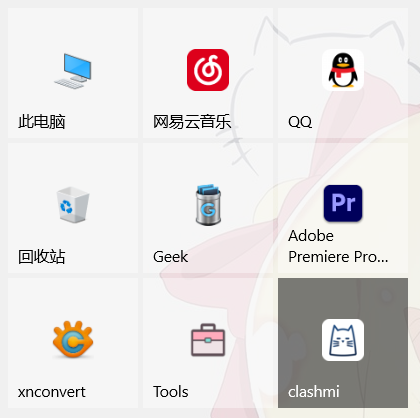

**深色主题：**

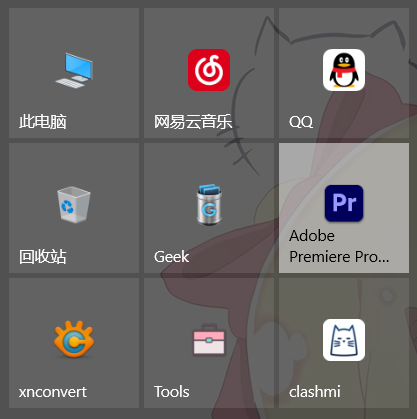

它的工作原理大概是：将应用固定到开始屏幕 → 系统将应用图标缓存为本地 PNG 文件 → 开始菜单初次启动时 → 直接读取缓存数据并实时分析色调 → 判断绘制深色/浅色透明磁贴

## 逆向分析 StartUI.dll

经过一番研究，最终在 `StartUI.dll` 中找到了两个关键函数：

- `GetThemeAwareBackgroundColor`
- `GetThemeAwareForegroundColor`

其中：

- `GetThemeAwareBackgroundColor`：用于决定磁贴背景的颜色。
- `GetThemeAwareForegroundColor`：用于决定磁贴上显示的应用名称文本颜色。

使用 IDA 加载 `StartUI.dll`，IDA 会自动下载对应的 `StartUI.pdb` 文件。随后可以在左侧函数列表中搜索到这两个函数。

### 函数信息

| 项目 | GetThemeAwareBackgroundColor | GetThemeAwareForegroundColor |
| --- | --- | --- |
| 起始地址 | `0x00000001801D8A54` | `0x00000001801D8ADC` |
| 结束地址 | `0x00000001801D8ADB` | `0x00000001801D8AEF` |
| 长度 | `0x87` | `0x13` |
| EA | `0x00000001801D8A54` | `0x00000001801D8ADC` |
| RVA | `0x1D8A54` | `0x1D8ADC` |

**注意：不同版本的 `StartUI.dll`，函数地址可能不同。**

### TileThemeSelector

两个函数入口处的寄存器中保存的就是 `TileThemeSelector`。

`TileThemeSelector` 的取值及对应效果如下：

| 值 | 磁贴背景 | 磁贴文字 |
| --- | --- | --- |
| `1` | 纯黑 | 白色 |
| `2` | 纯白 | 黑色 |
| `3` | 深色透明 | 白色 |
| `4` | 浅色透明 | 黑色 |

## 使用 Python 修改 StartUI.dll

本项目中的 Python 脚本通过函数特征定位 `GetThemeAwareBackgroundColor` 和 `GetThemeAwareForegroundColor` 的入口，并修改入口处的汇编指令。

具体实现方式是使用 Trampoline 跳转到 DLL 中的空闲区域（`0xCC`），在该区域执行赋值操作，将 `TileThemeSelector` 强制修改为用户选择的合法值（`1`、`2`、`3` 或 `4`），随后再跳回原函数继续执行。

由于原函数入口处的空间不足以直接容纳赋值指令和回跳指令，因此需要借助 Trampoline 实现跳转。

### 主题搭配

以下展示不同 `TileThemeSelector` 值与 Windows 浅色、深色主题组合时的实际效果。

#### 未修改的默认效果

**浅色主题：**

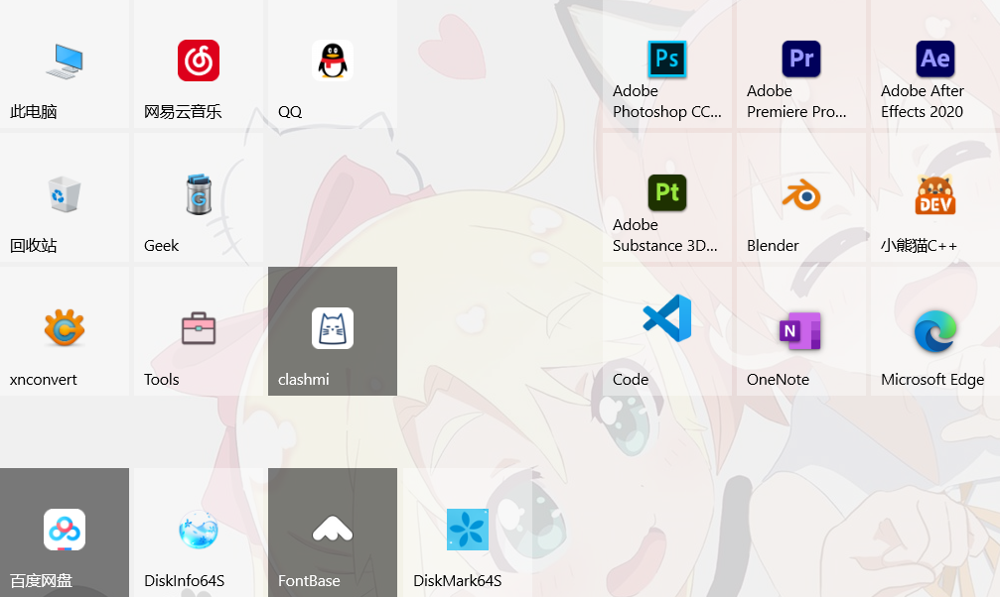

**深色主题：**

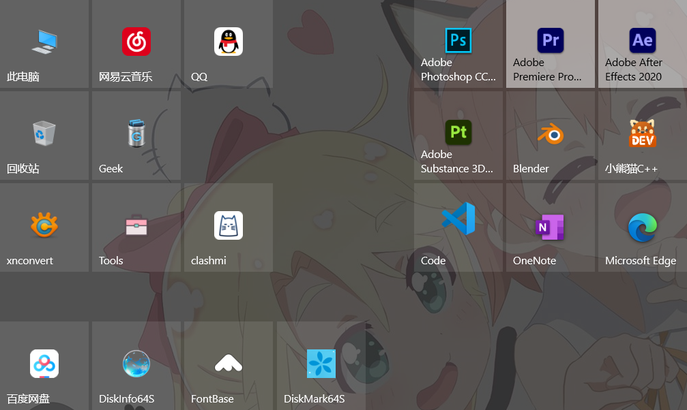

#### TileThemeSelector = 1

绘制纯黑磁贴，白色文字。

**浅色主题：**

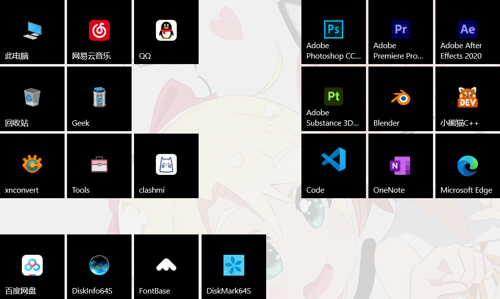

**深色主题：**

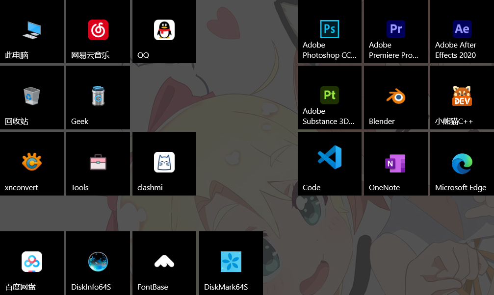

#### TileThemeSelector = 2

绘制纯白磁贴，黑色文字。

**浅色主题：**

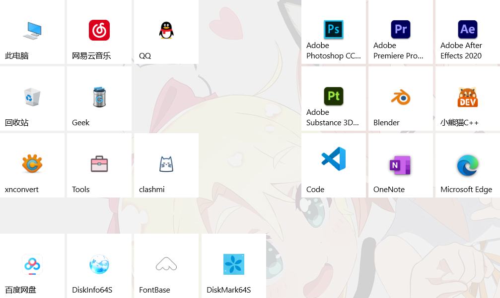

**深色主题：**

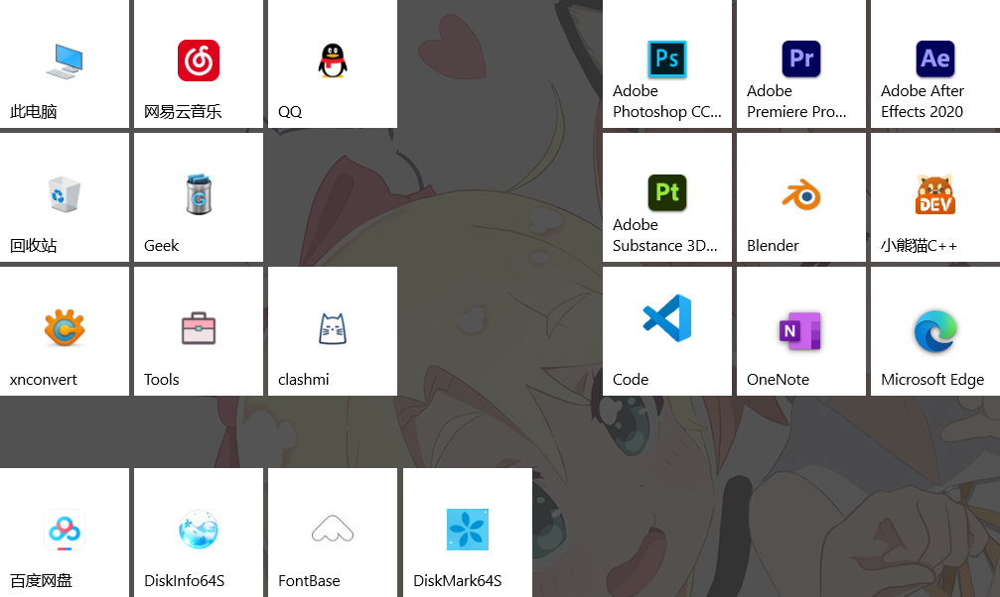

#### TileThemeSelector = 3

绘制深色透明磁贴，白色文字。

**浅色主题：**

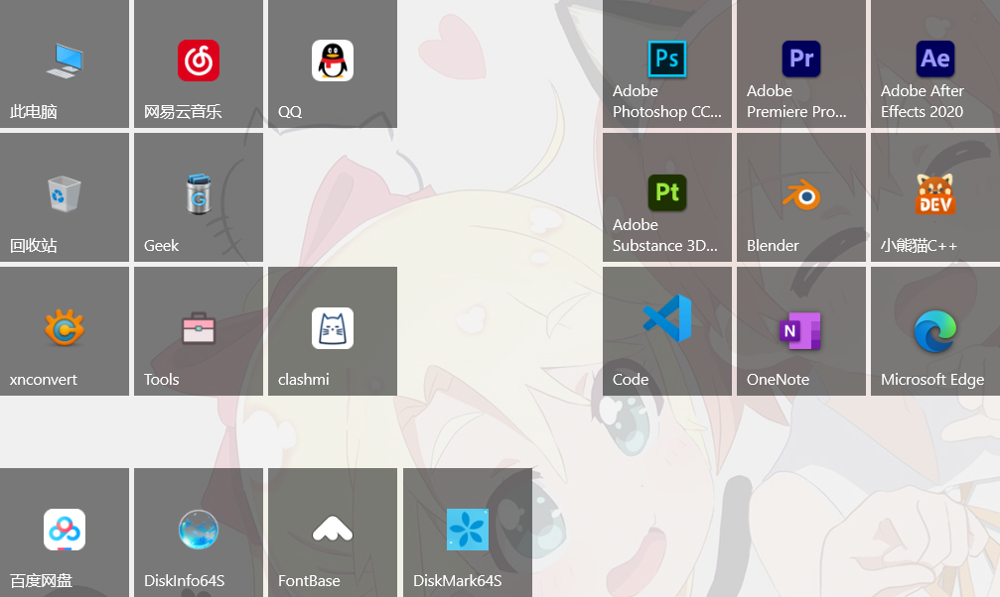

**深色主题：**

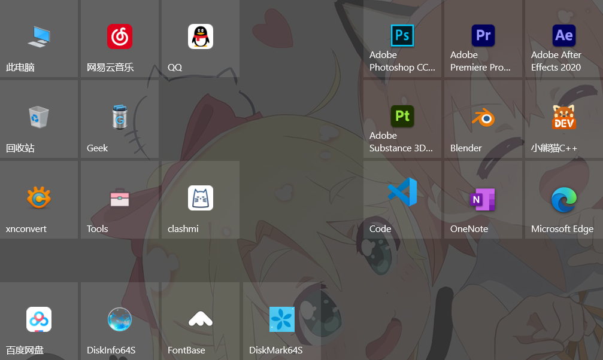

#### TileThemeSelector = 4

绘制浅色透明磁贴，黑色文字。

**浅色主题：**

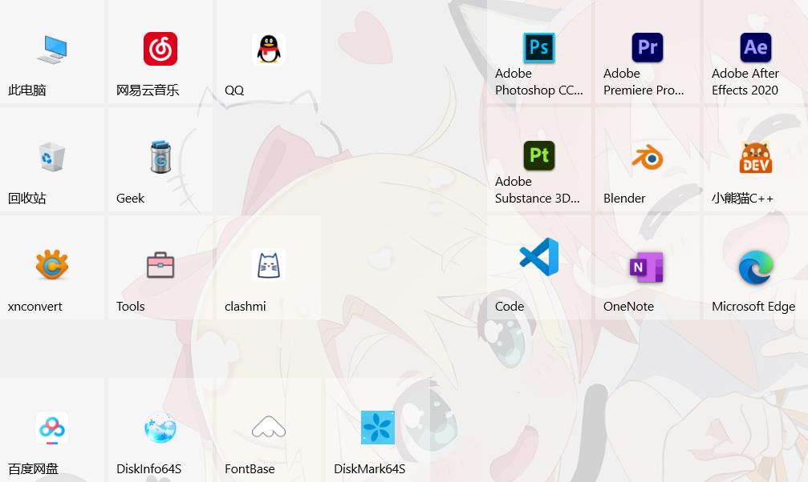

**深色主题：**

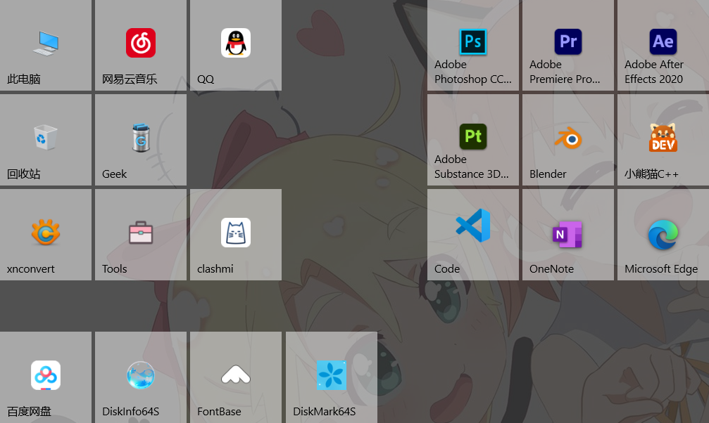

如果你使用浅色主题，推荐选 4；如果你使用深色主题，推荐选 3。

### 修改 StartUI.dll

使用 PowerShell 执行以下 Python 脚本：

```powershell
python StartUI_Trampoline_Patcher.py
```

## 替换 StartUI.dll

**务必先备份原始 `StartUI.dll` 文件。**

原始文件位置：

```text
C:\Windows\SystemApps\Microsoft.Windows.StartMenuExperienceHost_cw5n1h2txyewy\StartUI.dll
```

由于开始菜单进程（`StartMenuExperienceHost.exe`）的特殊性，即使手动结束该进程，Windows 也会立即重新启动它，导致 `StartUI.dll` 始终处于被占用状态。

使用本项目提供的 PowerShell 脚本即可完成替换。

### 替换流程

脚本执行过程如下：

1. 提醒用户手动备份原始 DLL。
2. 输入新 DLL 的路径。
3. 获取原 DLL 的操作权限。
4. 关闭开始菜单进程。
5. 使用 `MoveFileEx` 重命名旧 DLL。
6. 复制新 DLL，并验证 SHA256。
7. 立即将新 DLL 的 DACL 还原为原 DLL 的权限规则。
8. 权限设置成功后，删除重命名后的旧 DLL。
9. 等待 Windows 重新启动开始菜单进程。

### 执行替换

使用**管理员 PowerShell** 执行：

```powershell
.\Replace_StartUI.ps1
```

即可完成 `StartUI.dll` 的替换。

## 注意事项

- 不同版本的 `StartUI.dll`，函数位置可能不同，应以实际逆向分析结果为准。
- 使用系统文件检查器（SFC）执行 `sfc /scannow` 时，可以检测到 `StartUI.dll` 已被修改，并尝试修复该文件。修复通常会在重启电脑后生效，因此可能需要重新修改。
- Windows 更新可能会覆盖已修改的 `StartUI.dll`，届时可能需要重新修改。
- 修改系统文件存在风险，操作前请确认自己理解每个脚本的用途，并做好必要的备份。
